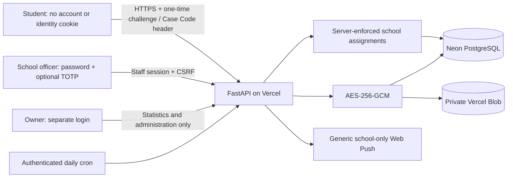

# School Edition architecture

Student codes contain 16 cryptographically random symbols (80 bits), formatted in four groups. Only an HMAC is stored. The code is never put in a URL, cookie, browser storage, analytics or logs. A browser reload clears the in-memory code. The database records the chosen school, optional victim/witness flag, status and encrypted conversation, not the student's network/device identity.

`officer_schools` is authoritative for every case list, detail, status, reply, note and attachment request. A foreign-school case returns 404. Owners cannot use officer routes or read cases through their statistics API. Student output contains no staff name, username, photo, private notes or internal audit data.

The `officers` table holds staff accounts with a role of `owner` or `officer`; only officer-role records appear in the owner's officer management list. Staff-only sessions store hashes, CSRF bindings and expirations. Credentials are Argon2id-hashed and all first sign-ins require a password change before privileged operations. TOTP secrets and push subscriptions are encrypted with contextual AES-GCM associated data.

Attachment bytes are sanitized before encryption and uploaded to private Blob with random object names. Downloads require a valid Case Code or an assigned, active officer session, then authenticate GCM and compare SHA-256. Original filenames and metadata are not stored. A failed database transaction queues an already-uploaded object for deletion.

Notifications are an outbox addressed only to officers assigned to the school. The payload names the school and links to the officer workspace, without message text, Case Code or student details. Disabled or reassigned officers lose sessions and relevant pending notifications.

Closed-case cleanup runs daily. It deletes messages/notes/cases, then deletes blob objects using a retry queue. Operational audit metadata survives case deletion; message contents do not. Anti-spam counters contain HMAC keys based on school/case/account/challenge, never IP or device information; expiry cleanup is automatic.

Migration 003 is an explicitly requested reset of the legacy reporting dataset. It drops all legacy report, evidence, message, credential, audit and temporary-upload tables before creating the School Edition schema. It does not create demonstration data. The one-time seed creates only an owner account from environment variables.
