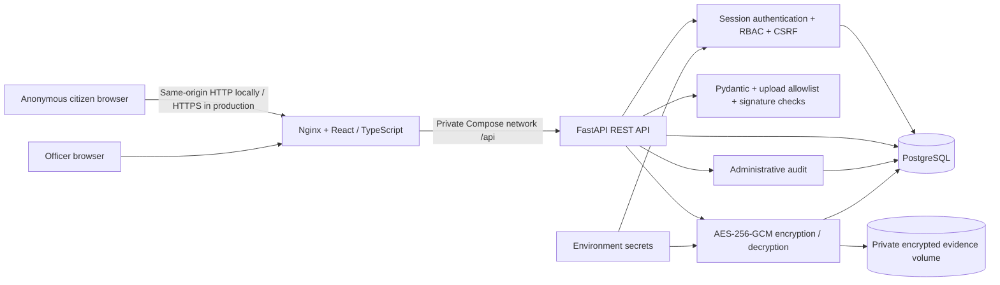
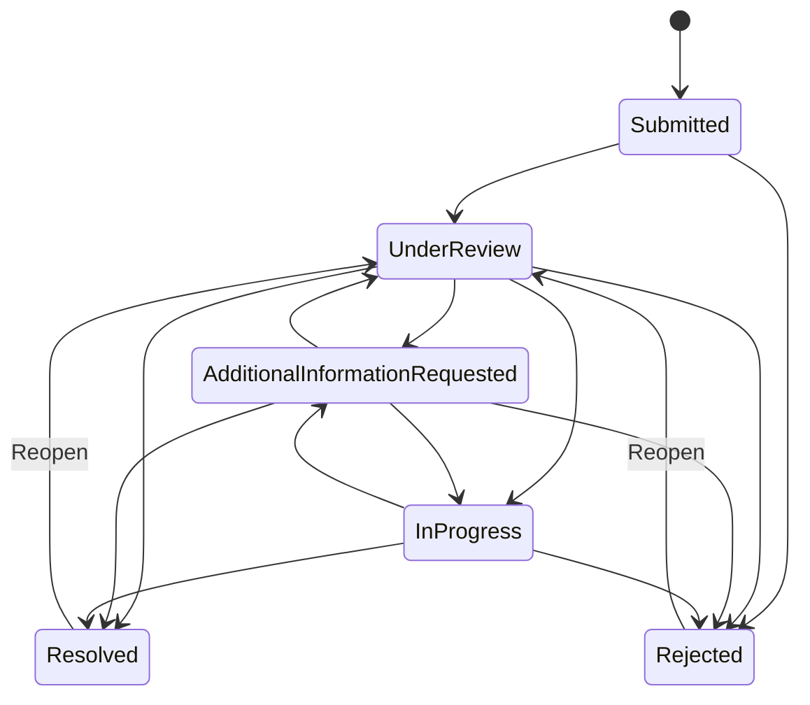

# Architecture

Created by Aslan Saidakhmet, Davlatbek, Dinmukhamed.

## Trust boundaries

The browser holds no encryption key or privileged authorization logic. The backend enforces every officer and citizen access check. Both browser roles can coexist using independent HttpOnly session cookies, scoped to `/api`. Session IDs and secret tokens contain 256 bits of cryptographic randomness; only HMAC-SHA256 digests are stored. HMAC uses a separate secret pepper. CSRF tokens are readable cookies bound by digest to each server-side session; unsafe session requests must send the correct token in a header. All mutations also require an application-specific request header and accept only the configured Origin when present. Cross-origin browser access has no CORS permission.

PostgreSQL uses bound SQLAlchemy queries. The upload volume is outside Nginx's document root. Authentication is required to fetch evidence; citizens can fetch only their report's evidence and officers can access submitted reports. A client role header selects the appropriate session when both cookies are present; it cannot grant a role without the matching authenticated server session.

## Data protection

| Data | Protection |
| --- | --- |
| Description, location | AES-256-GCM; associated data binds each value to report ID and field name |
| Messages and internal notes | AES-256-GCM bound to report ID; internal notes filtered server-side |
| Original filenames | AES-256-GCM bound to report ID |
| Evidence bytes | AES-256-GCM bound to report ID and evidence ID; random storage filename |
| Evidence integrity | GCM authentication plus stored SHA-256 of original plaintext bytes |
| Citizen access token | 32 random bytes, base64url; stored as HMAC-SHA256 only |
| Session IDs and CSRF secrets | Independent random tokens, stored as HMAC digests; 30-minute expiry |
| Officer passwords | Argon2id, 64 MiB memory, 3 iterations, parallelism 4, independent salts |
| Rate limit address keys | HMAC of scope and peer address; raw IP not stored by application |
| Category, status, dates/time, hashes and audit metadata | Plain database metadata; restricted by API authorization |

Each encryption operation generates a new 96-bit nonce. The 256-bit key is decoded from `ENCRYPTION_KEY`; startup fails if it or the token pepper is missing/invalid. Decryption authenticates the nonce, ciphertext, tag, and associated context before returning data. The API does not expose the key or return stored token hashes.

## State transitions

An officer is required for all status mutations. A report row lock serializes concurrent PostgreSQL status changes. The status update, history entry, and administrative audit entry commit in one database transaction. Sending a question does not implicitly change status; the officer explicitly chooses the appropriate status.

## Files and consistency

At most five files, each at most 10 MiB: JPG/JPEG, PNG, PDF, MP4, WebM. The suffix, supplied MIME type and signature must agree. Executable extensions and mismatched content are rejected. Original filenames are reduced to a basename, length limited, and encrypted. Stored files have random UUID names and owner-only permissions. Empty files are rejected. Nginx limits the overall request body to 51 MiB.

Uploads are validated before the report transaction. A failed transaction cleans up files already written. A process crash between file creation and database commit can leave an encrypted orphan; a production deployment needs a reconciliation job and durable backup policy. The authenticated download endpoint verifies both GCM and SHA-256 on every read. PDFs are download-only and uploaded HTML/SVG/scripts are not accepted. Signature checks are not deep parsing, malware scanning, or metadata removal.

## Operational notes

This is a single API service behind a same-origin reverse proxy. Database rate buckets use an atomic PostgreSQL upsert (SQLite equivalent in tests), so counts are shared across processes. No external services or actual government systems are used. Sessions and rate limit state live in PostgreSQL; API restarts do not erase them. Expired sessions are cleaned when issuing new ones. Administrative action logs are limited to identifiers and event names.

Production deployment requires HTTPS termination, a reviewed trusted proxy setup, secret rotation/migration planning, deletion/retention rules, infrastructure hardening, monitoring, and independent assessment. Those operational services are outside the local university demonstration. The source supports Docker/PostgreSQL and includes a Vercel/Neon deployment path; see DEPLOYMENT.md for encrypted database evidence and chunked transfer.
